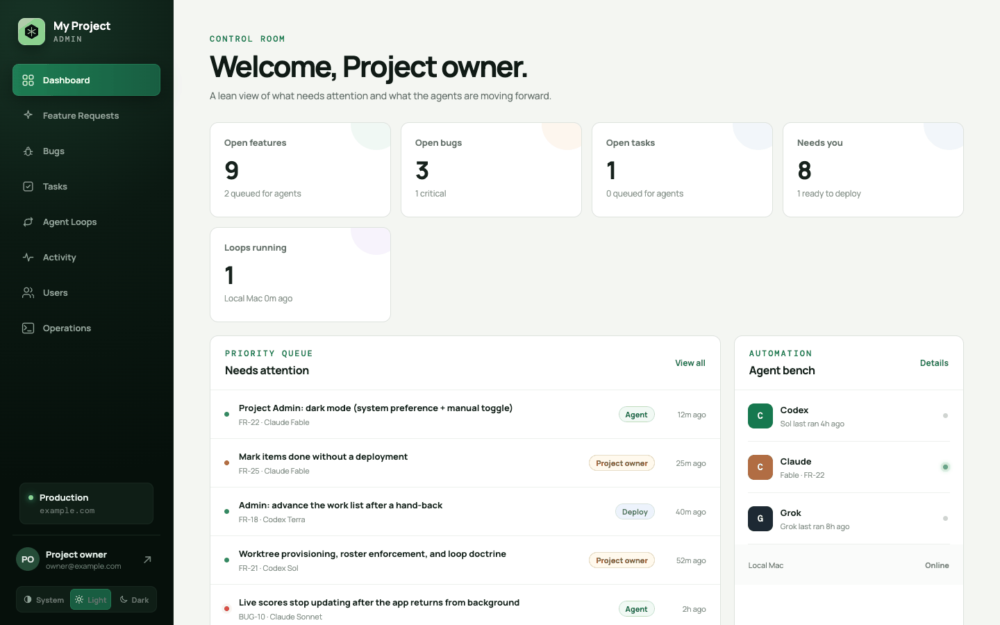
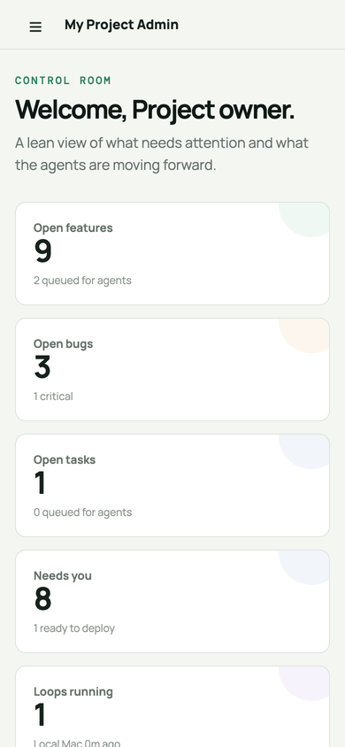
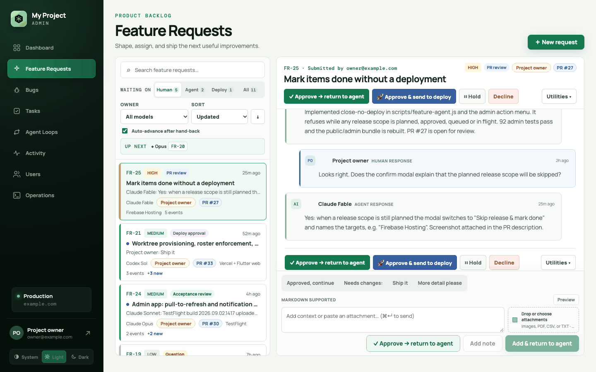
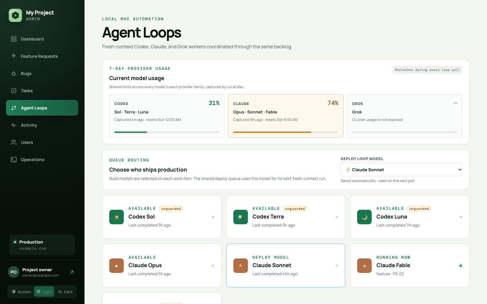

# Project Admin Kit

Project Admin Kit is a starter for running a software project with headless
coding agents under human control. It gives a repository a backlog of work
items (feature requests, bugs, tasks, or your own kinds), scheduled
fresh-context agent loops that claim items and open PRs in isolated worktrees,
explicit human gates for plans, PRs, deploys, and acceptance, and a deploy loop
that releases only a human-approved target set and records live proof. A React
console shows the backlog, threads, runs, machines, and provider usage. The
backlog store, agent CLIs, scheduler, work kinds, deploy targets, and repository
layout are all configuration in `project-admin.config.json`.

## Try it in 60 seconds

```bash
git clone https://github.com/<owner>/project-admin-kit.git && cd project-admin-kit
npm run install:all
npm run demo        # prints http://127.0.0.1:4318/admin/
```

`npm run demo` needs no Firebase project, GitHub token, or agent CLI. It builds
the console for the `local` backend into `.project-admin/demo/` (gitignored),
seeds a throwaway store there with feature, bug, and task items at every gate,
agent runs, a loop machine, and provider usage, and serves it on 127.0.0.1.
Click through approvals, threads, and the Agent Loops page; every run reseeds
the data. `--port <n>` changes the port; `--no-build` reuses the last build.
The backlog CLI works against the same store:

```bash
PROJECT_ADMIN_CONFIG=.project-admin/demo/project-admin.config.json \
  node scripts/work-agent.js --kind bug list --as opus
```

<table>
  <tr>
    <td width="66%"><picture><source media="(prefers-color-scheme: dark)" srcset="docs/images/dashboard-dark.png"></picture></td>
    <td rowspan="2"><picture><source media="(prefers-color-scheme: dark)" srcset="docs/images/mobile-dashboard-dark.png"></picture></td>
  </tr>
  <tr>
    <td><picture><source media="(prefers-color-scheme: dark)" srcset="docs/images/work-item-detail-dark.png"></picture></td>
  </tr>
  <tr>
    <td colspan="2"><picture><source media="(prefers-color-scheme: dark)" srcset="docs/images/agent-loops-dark.png"></picture></td>
  </tr>
</table>

Screenshots follow your light or dark preference; they come from the fixture
harness in [admin-app/screenshots/](admin-app/screenshots/README.md).

## Features

- **Work kinds as configuration.** Feature requests, bugs, and tasks ship by
  default; add your own with a prefix, plan review, deploy behavior, and
  runbook (`workKinds`).
- **Human gates.** Triage, questions, plan review, PR review, deploy approval,
  and acceptance all wait on a person. A deploy approval is an immutable
  snapshot of the PR, targets, commands, and verification the agent may run.
- **Pluggable backlog store.** Firestore (multi-user dashboard), a local JSON
  file (one person, no cloud account), or GitHub Issues (slash commands and
  labels, no dashboard) (`backend`).
- **Any agent CLI.** Runner adapters for Claude Code, Codex, and Grok, plus a
  generic `command` runner for Gemini CLI, opencode, aider, or anything else
  (`agents`).
- **Portable scheduling.** launchd, systemd user timers, cron, or a foreground
  scheduler for Docker and CI (`automation.scheduler`), with desktop, Slack,
  ntfy, or JSON-webhook alerts (`notifications`).
- **Deploy targets as configuration.** Firebase Hosting, Functions, rules,
  Vercel, Flutter web, Cloud Run, and TestFlight runbooks are built in; a new
  surface is a config entry plus a runbook (`deployments.targets`).
- **Fits existing repositories.** The kit can be the product repository, live
  in a subdirectory of one, or sit beside it (`layout.productRoot`), and
  `npm run kit:upgrade` 3-way merges later kit releases.
- **Operations console.** Responsive React/Vite app with dark mode: backlog,
  threads with attachments, routing by model, effort, and machine, run history
  with live progress, stale-run recovery, provider usage, and user management.
- **Optional extras.** Lifecycle email/push Functions, a SwiftUI iOS shell, and
  TestFlight release tooling ([extras/README.md](extras/README.md)).

## Choose your setup

Three independent choices; each is one key in `project-admin.config.json`.

| Choice | Options | Key | Guide |
|---|---|---|---|
| Backlog store | `firestore` (default): Google sign-in, many users, rules-enforced roles. `local`: one JSON file, one user, loopback console. `github`: Issues and slash commands; GitHub is the UI | `backend` | [docs/BACKENDS.md](docs/BACKENDS.md) |
| Scheduler | `launchd` (macOS default), `systemd` (Linux default), `cron`, `foreground` (`npm run loops`, Docker) | `automation.scheduler` | [scripts/agent-loops/README.md](scripts/agent-loops/README.md#provision-a-runner) |
| Layout | `self` (the kit is the product repository), `embedded` (in a subdirectory), `separate` (beside it) | `layout.productRoot` | [docs/LAYOUTS.md](docs/LAYOUTS.md) |

Every combination works, with these limits: the `local` store serves one
machine and one person, the `github` store has no dashboard and best-effort
claims, and the Functions and iOS extras need `firestore`.

### Firestore: a hosted dashboard for a team

```bash
node <this-kit>/scripts/create-project-admin.js my-app   # or clone the kit as my-app
cd my-app
npm run configure -- \
  --name "My App" \
  --firebase-project my-app-prod \
  --api-key '<firebase-web-api-key>' \
  --messaging-sender-id '<sender-id>' \
  --app-id '<web-app-id>' \
  --production-url 'https://my-app.example' \
  --owner-email 'you@example.com' \
  --owner-name 'Your name' \
  --repo 'your-org/my-app'
npm run install:all
gcloud auth application-default login
npm run bootstrap-admin
npm test && npm run test:rules && npm run build
firebase deploy --only hosting,firestore:rules,firestore:indexes,storage --project my-app-prod
```

Enable Google sign-in in the Firebase console and add the production domain to
its authorized domains. `bootstrap-admin` creates the owner's access record,
counters, and default routing; after that, manage people under
**Admin → Users**. [docs/SETUP.md](docs/SETUP.md) is the full checklist.

### Local: no cloud account

```bash
npm run configure -- --backend local --name "My App" --owner-email you@example.com --repo your-org/my-app
npm run install:all
npm run bootstrap-admin
npm run build
npm run local       # http://127.0.0.1:4317/admin/
```

The store is a JSON file under `~/.project-admin/<slug>/`, shared by every
worktree. The console has no authentication and listens on 127.0.0.1 only.

### GitHub Issues: no dashboard

```bash
npm run configure -- --backend github --name "My App" --owner-email you@example.com --repo your-org/my-app
npm run install:all
gh auth login       # or export GITHUB_TOKEN with Issues read/write
```

Open an issue labeled `pa:kind:feature` (or `bug`, `task`), then drive it with
comments such as `/agent`, `/approve plan`, `/approve pr`, `/approve deploy`,
and `/accept`. Only collaborators with write access are obeyed.

### Then start the loops

```bash
scripts/agent-loops/provision-machine.sh check     # CLIs, guard status, scheduler
scripts/agent-loops/provision-machine.sh install   # or: npm run loops
scripts/agent-loops/provision-machine.sh status
```

`scripts/agent-loops/machine-roster.json` says which agents and queues each
machine runs. Each loop polls from its own worktree, claims at most one item,
and leaves it at an explicit gate.

## Agent CLIs

| Runner | CLI | Containment |
|---|---|---|
| `claude` | Claude Code (`claude -p`) | `headless-guard.py` PreToolUse hook blocks catastrophic shell commands |
| `codex` | Codex (`codex exec`) | per-agent `sandbox` (`danger-full-access` by default); no guard |
| `grok` | Grok CLI (`grok -p`) | none |
| `command` | any CLI, from an argv template | none |

The sample roster defines seven agents (three Codex, three Claude, one Grok);
replace it with the ones you have. A CLI the kit does not know needs only a
config entry:

```jsonc
{ "token": "gemini", "label": "Gemini Pro", "runner": "command", "model": "gemini-2.5-pro",
  "command": ["gemini", "--model", "{{model}}", "--yolo", "--prompt", "{{prompt}}"] }
```

[docs/EXTENDING.md](docs/EXTENDING.md) covers that, writing a new runner
adapter, and adding work kinds, deploy targets, backends, and schedulers.
Unguarded agents are flagged in the loop log, the provisioner check, and the
console; read [SECURITY.md](SECURITY.md) before running any loop.

## Existing repositories and upgrades

`node scripts/install-into.js <product-repo> [--dir ops] [--mode embedded|separate]`
adds the kit to an existing repository ([docs/LAYOUTS.md](docs/LAYOUTS.md)).
Every copy records `.project-admin/kit-lock.json`, so
`npm run kit:upgrade -- --from <kit git URL or path>` can later merge upstream
fixes into kit-owned files without touching project-owned ones
([docs/UPGRADING.md](docs/UPGRADING.md), [CHANGELOG.md](CHANGELOG.md)).
Nothing is published to npm.

## Documentation

| Document | Covers |
|---|---|
| [docs/SETUP.md](docs/SETUP.md) | first-run checklist: Firebase, bootstrap, work kinds, automation, deploy targets |
| [docs/BACKENDS.md](docs/BACKENDS.md) | the three stores, their security models, GitHub slash commands and claims |
| [docs/ARCHITECTURE.md](docs/ARCHITECTURE.md) | surfaces, identity, work lifecycle, deploy approval, loop isolation |
| [docs/LAYOUTS.md](docs/LAYOUTS.md) | self, embedded, and separate layouts; hosting the console in each |
| [docs/EXTENDING.md](docs/EXTENDING.md) | adding agents, runners, work kinds, deploy targets, backends, schedulers |
| [docs/UPGRADING.md](docs/UPGRADING.md) | `kit:upgrade` and per-release migrations |
| [docs/deploy-targets/](docs/deploy-targets/firebase_hosting.md) | one runbook per built-in deploy target, plus a [Fly.io example](docs/deploy-targets/examples/fly.md) |
| [scripts/agent-loops/README.md](scripts/agent-loops/README.md) | loop lifecycle, schedulers, containers, notifications, backlog CLI |
| [scripts/agent-loops/runners/README.md](scripts/agent-loops/runners/README.md) | the runner adapter contract and the `command` runner |
| [extras/README.md](extras/README.md) | optional Functions, iOS shell, and TestFlight tooling |
| [AGENTS.md](AGENTS.md) | instructions for agents working in this repository, and the test matrix |
| [SECURITY.md](SECURITY.md) | threat model and vulnerability reporting |
| [CONTRIBUTING.md](CONTRIBUTING.md) | development setup, tests, and pull requests |

## License

[MIT](LICENSE). Participation is covered by the [Code of Conduct](CODE_OF_CONDUCT.md).
